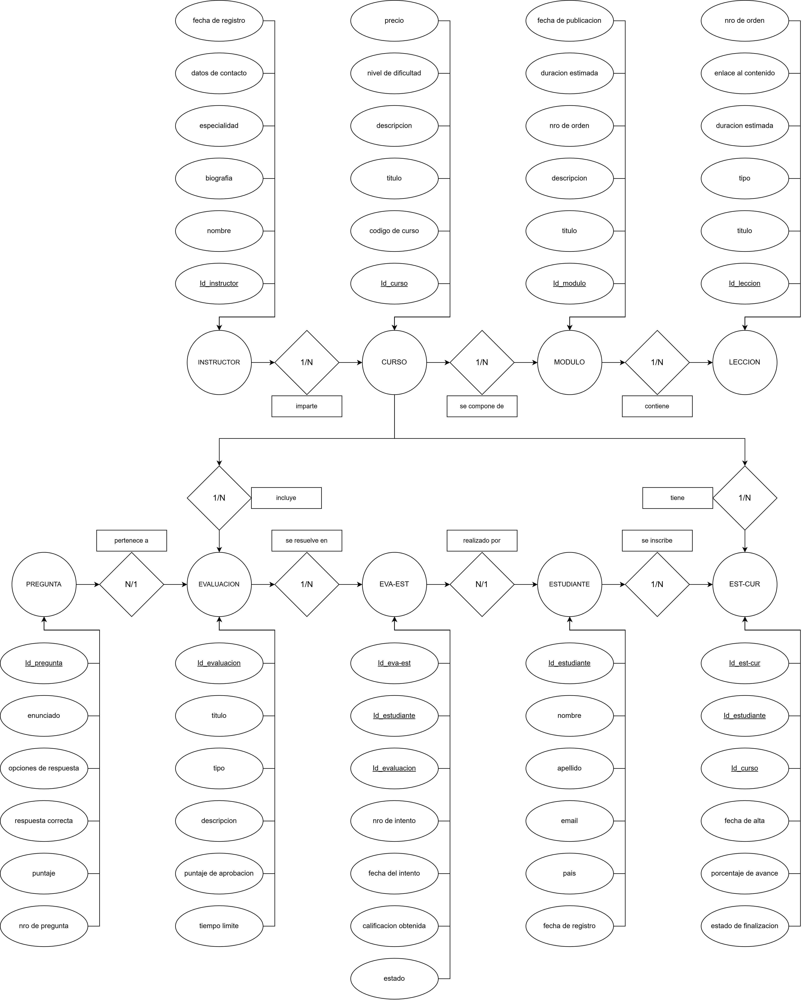

# BASE DE DATOS — Ejercicio 9: Plataforma de Gestión de Cursos Online y Evaluaciones (E-Learning)

Trabajo práctico de Base de Datos (Universidad Champagnat). Este repositorio contiene todo el desarrollo del ejercicio 9: modelo entidad-relación, modelo relacional y normalización (1FN, 2FN y 3FN).

## Consigna


#### Contexto


Una institución educativa virtual desea desarrollar una plataforma de e-learning para impartir cursos masivos abiertos online (MOOC). El sistema debe administrar instructores, catálogos de cursos temáticos, módulos de contenido en video o lectura, y un sistema de evaluaciones automatizadas con seguimiento de progreso del estudiante.


#### Consigna


Diseñar el modelo entidad-relación para la plataforma educativa considerando las reglas de negocio detalladas a continuación:

Los instructores se registran con su ID de instructor, nombre, biografía, especialidad y datos de contacto. Un instructor puede crear e impartir varios cursos.

Los cursos poseen un código de curso, título, descripción, nivel de dificultad (Principiante, Intermedio, Avanzado) y precio. Un curso está compuesto obligatoriamente por uno o varios módulos de aprendizaje ordenados secuencialmente.

Cada módulo contiene múltiples lecciones. Una lección puede ser de tipo video, lectura o recurso descargable, registrando su título, duración estimada y enlace al contenido digital.

Los estudiantes se registran en la plataforma. Un estudiante puede inscribirse en múltiples cursos a lo largo del tiempo. Por cada inscripción se registra la fecha de alta y el porcentaje de avance o estado de finalización del curso.

Cada curso incluye un conjunto de evaluaciones (cuestionarios o exámenes). Una evaluación consta de varias preguntas de opción múltiple. El estudiante realiza intentos de evaluación, registrando la fecha del intento, la calificación obtenida y el estado (Aprobado / Desaprobado).


#### Desarrollo requerido


Modelar la jerarquía estructural del curso: Curso $\rightarrow$ Módulo $\rightarrow$ Lección, estableciendo las relaciones de composición correspondientes.

Establecer la relación entre Instructor y Curso, y entre Estudiante y Curso (inscripción con atributos de seguimiento).

Diseñar el esquema de Evaluación, Pregunta y el registro de Intentos de Resolución por parte del estudiante.

Validar que la cardinalidad refleje con precisión la posibilidad de reutilización o unicidad de los contenidos pedagógicos.

## Estructura del repositorio

```
BASE_DE_DATOS_Ejercicio_9/
├── README.md
├── modelo-er/
│   ├── ejercicio_9.drawio        # diagrama editable (draw.io)
│   └── ejercicio_9.png           # exportación del diagrama
├── modelo-relacional/
│   ├── ejercicio_9_MR.xlsx               # modelo relacional
│   └── ejercicio_9_con_datos.xlsx        # modelo relacional con datos de ejemplo
└── normalizacion/
    ├── ejercicio_9_1FN.xlsx
    ├── ejercicio_9_2FN.xlsx
    └── ejercicio_9_3FN.xlsx
```

## Modelo entidad-relación



Archivo editable: [`modelo-er/ejercicio_9.drawio`](modelo-er/ejercicio_9.drawio).

## Modelo relacional

Tablas del modelo relacional original, antes de normalizar (`(PK)` clave primaria, `(FK)` clave foránea, `(UNIQUE)` valor único):

- **INSTRUCTOR**: `Id_instructor(PK)`, `nombre`, `biografia`, `especialidad`, `datos de contacto`, `fecha de registro`
- **CURSO**: `Id_curso(PK)`, `codigo de curso`, `titulo`, `descripcion`, `nivel de dificultad`, `precio`, `Id_instructor(FK)`
- **MODULO**: `Id_modulo(PK)`, `titulo`, `descripcion`, `n de orden`, `duracion estimada`, `fecha de publicacion`, `Id_curso((FK)`
- **LECCION**: `Id_leccion(PK)`, `titulo`, `tipo`, `duracion estimada`, `enlace al contenido`, `n de orden`, `Id_modulo(FK)`
- **PREGUNTA**: `Id_pregunta(PK)`, `enunciado`, `opciones de respuesta`, `respuesta correcto`, `puntaje`, `n de pregunta`, `Id_evaluacion(FK)`
- **EVALUACION**: `Id_evaluacion(PK)`, `titulo`, `tipo`, `descripcion`, `puntaje de aprobacion`, `tiempo limite`, `Id_curso(FK)`
- **EVA-EST**: `Id_eva-est(PK)`, `Id_evaluacion(FK,PK)`, `Id_estudiante(FK,PK)`, `n de intento`, `fecha de intento`, `calificacion obtenida`, `estado`
- **ESTUDIANTE**: `Id_estudiante(PK)`, `nombre`, `apellido`, `email(UNIQUE)`, `pais`, `fecha de registro`
- **EST-CUR**: `Id_est-cur(PK)`, `Id_estudiante(FK,PK)`, `Id_curso(FK,PK)`, `fecha de alta`, `porcentaje de avance`, `estado de finalizacion`

Archivos: [`ejercicio_9_MR.xlsx`](modelo-relacional/ejercicio_9_MR.xlsx) y [`ejercicio_9_con_datos.xlsx`](modelo-relacional/ejercicio_9_con_datos.xlsx).

## Lógica relacional

Cada entidad se convierte en una tabla con su clave primaria. Las relaciones se representan así:

- **1:N / N:1**: la clave primaria del lado "uno" se copia como clave foránea (FK) en la tabla del lado "muchos".
- **1:1**: igual que 1:N, pero la FK lleva restricción UNIQUE.
- **N:M**: se crea una tabla intermedia cuyas FK forman una clave compuesta, junto con una clave propia que se identifica por esa combinación.

Relaciones del modelo final (3FN):

- `CONTACTO INSTRUCTOR` → `INSTRUCTOR`: **N:1** (FK `id_instructor` en `CONTACTO INSTRUCTOR`).
- `CURSO` → `INSTRUCTOR`: **N:1** (FK `id_instructor` en `CURSO`).
- `MODULO` → `CURSO`: **N:1** (FK `id_curso` en `MODULO`).
- `LECCION` → `MODULO`: **N:1** (FK `id_modulo` en `LECCION`).
- `PREGUNTA` → `EVALUACION`: **N:1** (FK `id_evaluacion` en `PREGUNTA`).
- `OPCION DE RESPUESTA` → `PREGUNTA`: **N:1** (FK `id_pregunta` en `OPCION DE RESPUESTA`).
- `EVALUACION` → `CURSO`: **N:1** (FK `id_curso` en `EVALUACION`).
- `EVALUACION` ↔ `ESTUDIANTE`: relación **N:M**, resuelta con la tabla intermedia `EVA-EST` (sus FK forman la clave compuesta única).
- `ESTUDIANTE` ↔ `CURSO`: relación **N:M**, resuelta con la tabla intermedia `EST-CUR` (sus FK forman la clave compuesta única).

## Normalización

Los cambios se muestran etapa por etapa; cada etapa parte del resultado de la anterior.

### Primera forma normal (1FN)

- Tablas nuevas: `CONTACTO INSTRUCTOR`, `OPCION DE RESPUESTA`
- `INSTRUCTOR`: se quitan `datos de contacto`
- `PREGUNTA`: se quitan `opciones de respuesta`, `respuesta correcto`

### Segunda forma normal (2FN)

Sin cambios respecto de la etapa anterior: el modelo ya cumplía esta forma normal.

### Tercera forma normal (3FN)

- `MODULO`: se quitan `duracion estimada`
- `EVA-EST`: se quitan `estado`
- `EST-CUR`: se quitan `estado de finalizacion`

#### Modelo final en 3FN

- **INSTRUCTOR**: `Id_instructor(PK)`, `nombre`, `biografia`, `especialidad`, `fecha de registro`
- **CONTACTO INSTRUCTOR**: `Id_contacto(PK)`, `Id_instructor(FK)`, `tipo de contacto`, `valor de contacto`
- **CURSO**: `Id_curso(PK)`, `codigo de curso`, `titulo`, `descripcion`, `nivel de dificultad`, `precio`, `Id_instructor(FK)`
- **MODULO**: `Id_modulo(PK)`, `titulo`, `descripcion`, `n de orden`, `fecha de publicacion`, `Id_curso((FK)`
- **LECCION**: `Id_leccion(PK)`, `titulo`, `tipo`, `duracion estimada`, `enlace al contenido`, `n de orden`, `Id_modulo(FK)`
- **PREGUNTA**: `Id_pregunta(PK)`, `enunciado`, `puntaje`, `n de pregunta`, `Id_evaluacion(FK)`
- **OPCION DE RESPUESTA**: `Id_opcion(PK)`, `Id_pregunta(FK,UK1)`, `letra(UK1)`, `texto de la opcion`, `es correcta`
- **EVALUACION**: `Id_evaluacion(PK)`, `titulo`, `tipo`, `descripcion`, `puntaje de aprobacion`, `tiempo limite`, `Id_curso(FK)`
- **EVA-EST**: `Id_eva-est(PK)`, `Id_evaluacion(FK,PK)`, `Id_estudiante(FK,PK)`, `n de intento(PK)`, `fecha de intento`, `calificacion obtenida`
- **ESTUDIANTE**: `Id_estudiante(PK)`, `nombre`, `apellido`, `email(UNIQUE)`, `pais`, `fecha de registro`
- **EST-CUR**: `Id_est-cur(PK)`, `Id_estudiante(FK,PK)`, `Id_curso(FK,PK)`, `fecha de alta`, `porcentaje de avance`

Archivos: [`ejercicio_9_1FN.xlsx`](normalizacion/ejercicio_9_1FN.xlsx), [`ejercicio_9_2FN.xlsx`](normalizacion/ejercicio_9_2FN.xlsx), [`ejercicio_9_3FN.xlsx`](normalizacion/ejercicio_9_3FN.xlsx).
